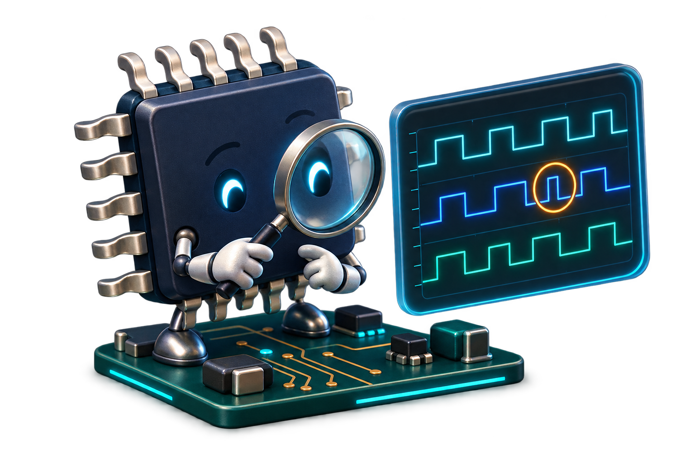

  

<h1 align="center">Hi, I'm Charan Gundepinni</h1>

  <strong>SoC &amp; ASIC Front-End · RTL Design &amp; Verification</strong> 
  SystemVerilog · UVM · AMBA AXI4/APB · RISC-V

  M.S. Electrical Engineering · Colorado State University · Expected December 2026 
  Seeking full-time roles in SoC/ASIC RTL design and design verification after graduation

  <a href="mailto:charangundepinni@gmail.com">charangundepinni@gmail.com</a> ·
  <a href="https://www.linkedin.com/in/charan-gundepinni">LinkedIn</a> ·
  <a href="https://github.com/Charan6556?tab=repositories">All Projects</a> ·
  <a href="#technical-skills">Technical Skills</a> ·
  <a href="#selected-projects">Selected Projects</a> ·
  <a href="#professional-experience">Professional Experience</a> ·
  <a href="#teaching-experience">Teaching Experience</a>

  
  
  
  
  
  

---

## [About Me](#about-me)

I'm an electrical engineering graduate student focused on **SoC and ASIC front-end design and verification**. I write **Verilog/SystemVerilog RTL** and then verify it myself with **UVM testbenches**, using reference models, **SystemVerilog Assertions (SVA)**, and functional coverage to check that the design does what it should.

Alongside my studies, I'm an **ASIC Design Verification Trainee at Maven Silicon**.

My projects are **SoC building blocks**: an AXI4 memory slave, APB peripherals, a synchronous FIFO, a packet router, and a **five-stage pipelined RV32I processor**. I take my RV32I, AXI4, and router designs through **logic synthesis (Yosys, Cadence Genus) on SKY130** to check timing and area. I also run **C programs on my own RV32I core**: a self-playing Snake game compiled with clang runs **56.9M instructions at 1.216 CPI** in Verilator.

Right now I'm building a **small RISC-V SoC** from my own blocks and adding **low-power features (UPF power gating, clock gating)** to my INT8 systolic array accelerator.

As a **Graduate Teaching Assistant for ECE 252 at Colorado State University**, I lead three labs each week and help students take digital circuits from Boolean logic to FPGA implementation. I also use Python, PyTorch, and TensorFlow for signal-processing and machine-learning projects.

## [Technical Skills](#technical-skills)

| Area | Skills demonstrated in my projects and teaching |
| --- | --- |
| **ASIC RTL & digital design** | Verilog, SystemVerilog, combinational and sequential logic, Mealy/Moore state machines, parameterized FIFOs, register interfaces, packet routing, processor design, systolic arrays |
| **SoC interfaces & AMBA protocols** | AXI4 memory-mapped slaves, five-channel handshakes, INCR bursts, byte strobes, narrow and unaligned accesses; AXI4-Lite control registers; APB multi-slave peripherals, transfers, and wait states |
| **UVM & IP verification** | Transactions, sequences, sequencers, drivers, monitors, agents, environments, virtual sequencers, analysis ports, virtual interfaces, configuration |
| **Functional verification** | Verification plans, directed and constrained-random stimulus, independent scoreboards, reference models, readback checks, boundary testing, error injection, mutation testing |
| **Assertions & coverage** | SystemVerilog Assertions, bound FIFO/FSM properties, APB protocol checks, coverpoints, cross coverage |
| **ASIC lint & synthesis** | Verilator RTL lint, Yosys and Cadence Genus logic synthesis, SKY130 standard-cell mapping, timing/QoR reports, synthesis netlists and cell-area reports |
| **Low-power design** | Clock gating, power gating, multi-VT, DVFS, UPF power-aware simulation (Xcelium), static and dynamic power analysis |
| **Simulation & waveform debug** | Cadence Xcelium, SimVision, Synopsys VCS, Verilator, waveform analysis, Perl multi-seed regression scripts |
| **Processor architecture** | RV32I five-stage pipeline: forwarding, load-use stalls, branch/jump flush; instruction formats and immediate decoding; bare-metal C on the core with performance counters; 8-bit nanoprocessor design |
| **Performance analysis** | CPI/IPC analysis, caches, branch prediction, multicore scaling, Sniper simulator, OpenMP |
| **Custom VLSI** | Transistor sizing, CMOS layout in Cadence Virtuoso (180 nm), DRC and LVS |
| **FPGA implementation & debug** | Intel Quartus, DE10-Lite, simulation-to-hardware debugging, latch identification, state-transition analysis, nanoprocessor implementation |
| **Programming & ML** | Python, PyTorch, TensorFlow, Pandas, NumPy, 1D CNNs, signal preprocessing |

### Additional technical background & tools

| Area | Background |
| --- | --- |
| **Languages** | C, C++, Perl, Tcl |
| **Interfaces & protocols** | UART, SPI, PCIe fundamentals |
| **EDA tools** | Synopsys Verdi, Design Compiler, SpyGlass, ModelSim, QuestaSim |
| **ASIC & FPGA concepts** | ASIC/FPGA design flows, static timing analysis (STA) basics, RTL lint, CDC/RDC and DFT fundamentals |
| **Development environment** | Linux, Git, Make, clang/LLVM |

## [Selected Projects](#selected-projects)

### [RV32I Five-Stage Pipelined Processor — RTL, UVM & Synthesis](https://github.com/Charan6556/RISCV-32I)

An in-order, five-stage pipeline implementing the 37 RV32I base integer instructions, with EX/MEM and MEM/WB forwarding, load-use stall detection, and branch/jump resolution in EX with pipeline flush.

- **UVM verification:** commit-based reference scoreboard, 10 bound SVA properties, and functional coverage: **100% of the 37 instruction bins** and 98.41% pipeline coverage (seed 25: 682 commits, 0 scoreboard errors).
- **Regression:** **1,000 seeds passed, 0 failures**, each running 80 directed + 60 random instructions (**60,000 random instructions** in total). Traced 12 earlier failing seeds to a signed-shift bug in the scoreboard's reference model.
- **C program on the core:** a self-playing Snake game compiled with clang runs on the RTL in Verilator: **56,912,196 instructions at 1.216 CPI**. The performance counters account for every cycle: load-use stalls, 2 cycles per taken branch, and 4 cycles of pipeline fill.
- **Program run:** Bubble Sort sorted correctly in 169 cycles for 121 retired instructions (CPI 1.40).
- **ASIC front-end flow:** Cadence Genus synthesis on SKY130 HD met a **4 ns (250 MHz)** pre-layout target at the typical corner, 71,967 µm² cell area.

[Coverage evidence](https://github.com/Charan6556/RISCV-32I/blob/main/docs/images/coverage-seed25.png) · [Regression evidence](https://github.com/Charan6556/RISCV-32I/blob/main/docs/images/regression-1000-pass.png) · [Synthesis report](https://github.com/Charan6556/RISCV-32I/blob/main/synth/reports/4ns/qor.rpt) · [Debugging notes](https://github.com/Charan6556/RISCV-32I/blob/main/docs/debugging.md) · [Snake demo](https://github.com/Charan6556/RISCV-32I/tree/main/riscv_snake_demo)

### [AXI4 Memory Slave — RTL & UVM Verification](https://github.com/Charan6556/axi4-memory-slave-uvm)

A 16 KB AXI4 memory-mapped slave with five independent channels, 32-bit data, INCR bursts of up to 256 beats, and one outstanding burst per read/write direction.

- Built a UVM master agent with separate read/write sequencers and drivers, a handshake monitor, and a byte-addressed reference-memory scoreboard checking IDs, data, responses, and final-beat behavior.
- Verified byte strobes, narrow and unaligned accesses, memory and 4 KB page boundaries, error responses, and constrained-random traffic.
- **Recorded Xcelium full-test run:** 178 writes, 151 reads, zero skipped bytes, **100% of the defined command, write-data, and response functional coverage bins**, and zero UVM warnings, errors, or fatals.
- **100-seed regression:** `axi_full_test` passed on **all 100 seeds**, each meeting 100% of the defined coverage bins with zero UVM errors or fatals and zero skipped bytes.
- **ASIC front-end flow:** Cadence Genus synthesis of a scaled 256-byte variant on SKY130 HD at 100 MHz: **+2.22 ns worst setup slack**, zero violating paths, **74,943 µm²** mapped cell area. Caught and fixed an address-range mismatch in the scaled variant before the final run.

[Full-test evidence](https://github.com/Charan6556/axi4-memory-slave-uvm/blob/main/docs/images/axi_full_seed1.png) · [Regression evidence](https://github.com/Charan6556/axi4-memory-slave-uvm/blob/main/docs/regression_100_seeds.png) · [Synthesis evidence](https://github.com/Charan6556/axi4-memory-slave-uvm/blob/main/docs/synthesis_256b_qor.png) · [Verification flow](https://github.com/Charan6556/axi4-memory-slave-uvm/blob/main/docs/images/axi_uvm_flow.png) · [Tests & current scope](https://github.com/Charan6556/axi4-memory-slave-uvm#tests)

### [1×3 Packet Router — RTL & UVM Verification](https://github.com/Charan6556/router-1x3-uvm)

An 8-bit packet router with one input and three output FIFOs, verified with coordinated UVM agents, packet scoreboarding, directed boundary cases, constrained-random traffic, parity-error injection, and bound FIFO/FSM assertions.

- **Recorded Xcelium regression:** 5,024 matched packets, zero mismatches, and **100% of the defined functional coverage model**.
- **Checker validation:** a separate recorded mutation test detected 74 mismatched packets after intentional output corruption.
- **ASIC front-end flow:** Verilator lint, Yosys synthesis, and SKY130 standard-cell mapping, with preserved netlists and a reported mapped cell area of **23,804.08 µm²**.

[Regression evidence](https://github.com/Charan6556/router-1x3-uvm/blob/main/reports/xcelium_sva_regression.txt) · [Mutation-test evidence](https://github.com/Charan6556/router-1x3-uvm/blob/main/reports/mutation_test.txt) · [Synthesis evidence](https://github.com/Charan6556/router-1x3-uvm/blob/main/reports/synthesis_summary.txt) · [Architecture & testbench guide](https://github.com/Charan6556/router-1x3-uvm/blob/main/docs/testbench_guide.md)

### [APB Multi-Slave — Protocol & UVM Verification](https://github.com/Charan6556/APB-Multi-Slave-UVM-Verification)

An APB subsystem with two memory-mapped slaves, including zero-wait and two-wait-state responses.

- Built requester-side stimulus, a completed-transfer monitor, per-slave reference memories, and readback checking.
- Added assertions for protocol sequencing, slave selection, and signal stability during wait states.
- **Recorded run:** 20 monitored transfers, **100% of the defined functional coverage model**, and zero UVM warnings, errors, or fatals.

### [Synchronous FIFO — RTL & UVM Verification](https://github.com/Charan6556/Synchronous-FIFO-UVM-Verification)

A parameterized FIFO with an independent queue-based scoreboard and assertions for reset, occupancy, and pointer behavior.

- Checked full/empty boundaries, data ordering, and blocked overflow/underflow attempts with directed fill-and-drain sequences.
- **Recorded run:** 16 accepted writes, 16 accepted reads, no remaining reference entries, and zero UVM warnings, errors, or fatals.

### In Progress

- **INT8 Systolic Array Accelerator:** 4×4 output-stationary array (16 INT8 MACs) with an AXI4-Lite control slave, 117 self-checking tests, and 250 MHz on SKY130 (94,283 µm²). Adding UPF power gating and clock gating now. Repo coming soon.
- **RISC-V SoC:** integrating my RV32I core, on-chip SRAM, and the AXI4 memory slave with APB peripherals, plus branch prediction and an L1 cache. Target is Tiny Tapeout.

### Coursework Projects

- **Computer Architecture (ECE 452):** compared in-order and out-of-order cores in Sniper (3.7× IPC for 1.7× power), swept cache sizes, branch predictors, and core counts (4–64), and measured OpenMP scaling on an 8-core Apple M3 (4.7× speedup).
- **VLSI Design (ECE 571):** sized NAND2 gates for 100–500 fF loads in Cadence Virtuoso (180 nm), drew the layouts with fingering, and passed DRC and LVS.

<strong>More projects: SystemVerilog foundations & machine learning</strong>

 

- **[SystemVerilog Class-Based Verification](https://github.com/Charan6556/SystemVerilog-Class_Based_Verification):** Modular environments for a mux, full adder, and synchronous counter using transactions, mailboxes, virtual interfaces, and self-checking scoreboards.
- **[ECG Arrhythmia Classification](https://github.com/Charan6556/ECG-Arrhythmia-Classification):** An educational five-class heartbeat classifier using Python, TensorFlow, a 1D CNN, signal preprocessing, and an experimental ECG trace-extraction pipeline. The repository documents recorded results and evaluation limitations.

## [Professional Experience](#professional-experience)

### ASIC Design Verification Trainee · Maven Silicon

**January 2026 – Present**

- Developed **Verilog RTL for digital designs** as part of **ASIC front-end training**.
- Built foundational knowledge of **static timing analysis (STA), FPGA architecture, RISC-V, and design for test (DFT)**.
- Developed **SystemVerilog/UVM testbenches** using **directed and constrained-random tests**.
- Used **SystemVerilog Assertions (SVA) and functional coverage** to check design behavior and track exercised scenarios.
- Debugged **RTL and testbench issues** using **Synopsys VCS and Verdi**.
- Mentored peers in **Verilog, SystemVerilog, UVM, and RTL design**.

## [Teaching Experience](#teaching-experience)

### Graduate Teaching Assistant · Colorado State University

**ECE 252 — Introduction to Digital Circuits · Fall 2026**  
Working with **Prof. Anura Jayasumana**

- Lead **three lab sessions each week**, taking students from truth tables and Karnaugh maps through schematic capture and Verilog in Quartus to FPGA implementation on the **DE10-Lite**.
- Hold office hours on Boolean algebra, flip-flops, and Mealy and Moore state machines.
- Help students find unintended latches, trace wrong state transitions, and debug differences between simulation and the FPGA.
- Grade lab reports and help students explain how logic, timing, and state transitions affect their results.

#### Hardware Build: 8-Bit Nanoprocessor

For the lab interview, I designed an **8-bit nanoprocessor from scratch in Quartus** and demonstrated it on the **DE10-Lite FPGA**. It had a gate-level adder/subtractor, a **4×4 array multiplier**, a control ROM, and a register bank.

  

## [How I Approach Design](#how-i-approach-design)

- **Start from the spec, not the code:** write down the features and edge cases first, then build block by block (my AXI4 slave was built from a written spec: bursts, WSTRB, unaligned starts, SLVERR).
- **Safe defaults, no latches:** every combinational block assigns a default first, then overrides per case (my RV32I decoder starts from a NOP control word).
- **Small blocks:** separate read and write controllers, one module per datapath step, so each piece can be tested and explained on its own.
- **Measure, don't guess:** lint before simulation (router: zero Verilator warnings), check synthesis numbers, and use performance counters to explain where every cycle goes (RV32I: CPI 1.216 broken down into stalls and branch flushes).

## [How I Approach Verification](#how-i-approach-verification)

- **Build the expected result separately** with a reference model, so the design can't hide its own bugs.
- **Start with the edge cases:** reset, full/empty, protocol wait states, and bad traffic.
- **Test the checker:** inject a bug on purpose and make sure the test fails (router mutation test: 74 bad packets caught).
- **Keep the proof:** save scoreboard results, coverage reports, and waveforms for every result I report.

## [Education](#education)

**Colorado State University**  
M.S. in Electrical Engineering · GPA: 3.611 · Expected December 2026  
Coursework: Computer Architecture, VLSI Design, Semiconductor Memory, Digital Design, Machine Learning

**VNR Vignana Jyothi Institute of Engineering and Technology**, Hyderabad, India  
B.Tech in Electronics and Communication Engineering · 2020 – 2024

---

  Interested in SoC/ASIC RTL design and design verification opportunities. 
  <a href="mailto:charangundepinni@gmail.com"><strong>charangundepinni@gmail.com</strong></a> ·
  <a href="https://www.linkedin.com/in/charan-gundepinni"><strong>Let's connect on LinkedIn</strong></a>

